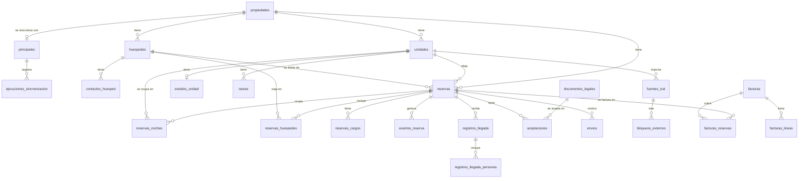

# Modelo de datos

**Estado:** borrador · 2026-11-03 · fases 1 y 2 · esfuerzo xhigh
Índice: [README.md](README.md) · origen de los datos: [subordinacion.md](subordinacion.md) ·
producto: [../producto.md](../producto.md)

Define las tablas de AlojaFlow, quién escribe en cada una y las reglas que protegen los datos.
Abarca la fase 1 completa (módulos M1–M11) y deja diseñadas las tablas de la fase 2, que se
construyen después. Las tablas que aporta el framework y sus paquetes (`users`, `sessions`,
`jobs`, `roles`…) se citan sin detallar.

---

## Resumen

1. **Tres capas.** El **espejo** (`hd_*`) guarda la copia de la principal tal como viene. La
   **proyección** convierte el espejo al modelo propio y la escribe solo la sincronización. Los
   **datos propios** los escriben los usuarios y nunca los toca la sincronización. Los módulos
   solo leen la proyección y los datos propios.
2. **`origen` y `sincronizada` son cosas distintas.** `origen` dice de dónde vino una fila
   (`hoteldruid` o `alojaflow`). `sincronizada` dice si hoy la controla la principal. Para migrar
   a la fase 2 basta con cambiar `sincronizada` a falso: no se mueven filas ni cambian las
   referencias.
3. **La ocupación se guarda noche por noche** en `reservas_noches`. Un índice único sobre
   (unidad, fecha, exclusiva) hará que en la fase 2 la base de datos rechace una doble reserva.
   En la fase 1 tolera los solapes que ya vengan de la principal. La misma tabla calcula
   ocupación, ADR y RevPAR.
4. **Importes en enteros** en la unidad menor de la moneda (centavos o lo que corresponda), con
   la moneda ISO 4217 al lado. **Fechas de estancia en `DATE`**; las horas, en `DATETIME` y UTC.
5. **Datos personales** con cifrado donde hace falta: números de documento, archivos de
   identidad, firmas y credenciales. Cada tipo de dato tiene su plazo de conservación (§8).

---

## Diferencias con lo implementado (1.0.5)

Lo programado sigue este diseño, salvo:

- **`plantillas`:** sin columna `canal` ni fila «de la instalación»: cada propiedad tiene las suyas y se mandan por
  el canal que se elija. El texto va en JSON por idioma, sin `spatie/laravel-translatable` (D-045).
- **`automatizaciones`:** sin acción `webhook`; los avisos a otros sistemas se configuran aparte, en `webhooks`.
- **`envios`:** un estado más, `manual` (listo para copiar, sin correo configurado), y `webhook_id`.
- **`bloqueos_externos`, `fuentes_ical`:** llevan `propiedad_id`; `fuentes_ical` lleva `nombre`.
- **`registros_llegada_personas`:** nacionalidad y país como texto, sin `symfony/intl` (D-048). Sin `tipos_documento`
  ni `parentescos`: los tipos de documento los da el paquete de país.
- **`exclusiones_aviso`** se creó como `omisiones`, con una casilla por lugar (D-074).
- **No creadas:** `envios_autoridad`, `fichas_huesped`, `canales_alias`, `subdivisiones`,
  `equivalencias`, `reservas_dias_limpieza`.
- **`facturas`:** sin encadenamiento de VeriFactu ni `sustituye_a_id`. `emisor` guarda copia, igual que `receptor`.
- **`entidades_fiscales`:** pertenecen a una propiedad.
- **`planos_unidades`:** solo posición, en porcentaje.

---

## 1. Principios y convenciones

### 1.1 Nombres

- **Tablas** en español, en plural y en `snake_case`, sin acentos ni ñ: `reservas`, `unidades`,
  `huespedes`, `reservas_noches`.
- **Columnas** en singular: `llegada`, `unidad_id`, `importe`. Claves foráneas
  `<singular>_id`. Booleanos como adjetivo o participio: `activa`, `sincronizada`, `cifrado`.
- **Marcas de tiempo propias:** `creado_en` y `actualizado_en`, definidas en un modelo base
  (`const CREATED_AT = 'creado_en'`, `const UPDATED_AT = 'actualizado_en'`). Las tablas del
  framework y de los paquetes conservan las suyas (`created_at`). Propuesta D-018.
- Las demás horas también terminan en `_en` (`enviado_en`, `resuelto_en`); las fechas, sin sufijo
  (`llegada`, `fecha`, `vencimiento`).
- **Modelos Eloquent** con `$table` explícito (convención del `CLAUDE.md`).
- **Nombres italianos** solo en las tablas del espejo (`hd_prenota`) y dentro del módulo de
  sincronización.

### 1.2 Claves e identificadores públicos

- **Clave primaria `id`** `BIGINT UNSIGNED AUTO_INCREMENT` en todas las tablas propias.
- **Nunca se expone un `id` secuencial a personas de fuera** (huéspedes, portales). Para eso hay:
  - **`reservas.codigo_publico`:** 10 caracteres aleatorios sin caracteres ambiguos, para los
    mensajes al huésped.
  - **Enlaces públicos** (pre-check-in, contrato, iCal): un token aleatorio de 32 bytes por
    enlace (§4.6).
- **Números visibles para el personal:** `reservas.numero` («7/2026» si viene de HotelDruid; un
  consecutivo por propiedad en la fase 2).

### 1.3 Dinero

- Importes en **`BIGINT` con signo**, en la **unidad menor** de la moneda. Los decimales de cada
  moneda se toman de ISO 4217 vía `symfony/intl` (MIT): MXN y EUR tienen 2, CLP tiene 0.
- Las columnas no llevan sufijo (`total`, `pagado`). Un cast `Dinero` las convierte en un objeto
  con importe y moneda.
- **La moneda va junto al importe:** `moneda CHAR(3)` en cada tabla con importes. En la fase 1
  los totales se suman por moneda, sin convertir.
- **Porcentajes** en `DECIMAL(7,4)` (12.5000 = 12.5 %).
- **Excepción:** en las líneas de factura, el valor unitario y la cantidad van en
  `DECIMAL(20,6)`, porque los formatos fiscales (CFDI y otros) admiten más decimales. Los totales
  de la factura vuelven a ir en unidad menor.
- **Redondeo:** a la unidad menor, mitad hacia arriba. Si un total se reparte (por noches, por
  líneas), el resto va a las primeras partes, para que la suma dé siempre el total exacto.

### 1.4 Fechas, horas y zonas

- **Estancias:** `llegada` y `salida` en `DATE`; la salida no cuenta como noche. Restricción
  `CHECK (salida > llegada)`.
- **Momentos** (envíos, aceptaciones, registros): `DATETIME` en **UTC**. Se usa `DATETIME` y no
  `TIMESTAMP` para no tener el límite de 2038.
- **Zona horaria por propiedad** (`propiedades.zona_horaria`, IANA). Se usa para la «fecha
  operativa» (qué es «hoy» en el alojamiento) y para mostrar las horas.
- **La aplicación trabaja en UTC** (`APP_TIMEZONE=UTC`) y la conexión de la base de datos usa
  `+00:00`.

### 1.5 Textos, idiomas e intercalación

- `utf8mb4` en todo. Intercalación moderna de cada motor, que no distingue mayúsculas ni
  acentos: `utf8mb4_0900_ai_ci` en MySQL y `utf8mb4_uca1400_ai_ci` en MariaDB. **El código no
  depende de las diferencias entre ellas**, y la CI prueba en los dos motores.
- **Contenido traducible del usuario** (nombres de canales, plantillas, políticas, descripciones
  de unidades): columnas JSON por idioma con `spatie/laravel-translatable` (MIT), con el idioma
  de la propiedad como respaldo. Propuesta D-021.
- **Excepción:** los documentos legales van en una fila por idioma y versión, porque cada texto
  aceptado necesita su propia huella (§4.6).
- **Idiomas** en BCP 47 `VARCHAR(12)` (`es`, `es-MX`, `pt-BR`). **Países** en ISO 3166-1
  `CHAR(2)`. **Subdivisiones** en ISO 3166-2 `VARCHAR(6)` (`MX-ROO`, `ES-B`, `US-CA`).

### 1.6 Enumeraciones

- `VARCHAR(30)` con un **enum de PHP** respaldado por cadenas en español (`'confirmada'`). No se
  usa el tipo `ENUM` de MySQL, para que añadir un valor no exija migrar.
- Donde un valor inválido haría daño, se añade un `CHECK` con la lista de valores.

### 1.7 Integridad y borrado

- **Siempre** claves foráneas con índice. El comportamiento al borrar se elige en cada caso:
  - `RESTRICT` por omisión;
  - `CASCADE` solo para hijos que no existen sin el padre (las noches de una reserva);
  - `SET NULL` para referencias opcionales (la tarea asignada a un usuario que se elimina).
- **Sin borrado lógico por costumbre.**
  - Los catálogos se desactivan (`activa = false`).
  - Las reservas que desaparecen de la principal se marcan (`eliminada_en_principal_en`).
  - Los documentos fiscales y las aceptaciones son **inmutables**: no se cambian ni se borran
    fuera de los plazos de §8.

### 1.8 Datos personales y cifrado

| Dato | Trato |
|---|---|
| Número y soporte del documento de identidad | Cifrado con el cast `encrypted`, más un `*_hmac` (HMAC-SHA256 con una clave propia) para buscar por coincidencia exacta y detectar duplicados |
| Archivos de identidad, firmas y copias de aceptaciones | Cifrados en disco, en una carpeta privada (§4.12) |
| Credenciales (principal, PAC, portales iCal, webhooks) | Cifradas |
| Tokens de enlaces públicos | Cifrados más HMAC (§4.6) |
| Nombre, correo, teléfono, domicilio | Sin cifrar: hacen falta para buscar y para enviar mensajes. Los protegen el acceso a la base de datos, los permisos y las copias de seguridad cifradas |

**La clave de cifrado de Laravel (`APP_KEY`) y la del HMAC son críticas.** El instalador las crea,
la copia de seguridad avisa de que no las incluye y el panel recuerda guardarlas aparte.

### 1.9 Compatibilidad MySQL 8.4 / MariaDB 11.4

- Sirven en los dos motores: `CHECK`, columnas generadas (`STORED`/`VIRTUAL`), JSON (en MariaDB es
  `LONGTEXT` validado) e índices únicos con varias filas `NULL`.
- **No se usan** índices funcionales (MariaDB no los tiene): en su lugar, columna generada más
  índice.
- Los `CHECK` se crean en la migración con una sentencia SQL, porque el constructor de esquemas
  de Laravel no los genera.

---

## 2. Las tres capas y quién escribe

| Capa | Tablas | Escribe | Lee |
|---|---|---|---|
| **Espejo** | `hd_*` | Solo la sincronización | Solo la sincronización (para proyectar) |
| **Proyección** | `unidades`, `huespedes`, `contactos_huesped`, `campos_huesped`, `reservas`, `reservas_noches`, `reservas_huespedes`, `reservas_cargos`, `reservas_dias_limpieza`, `cajas`, `movimientos`; en una entrega posterior, `planes_tarifarios` y `precios` | La sincronización mientras `sincronizada = true`; la aplicación en la fase 2 | Todos los módulos |
| **Propios** | Todas las demás | La aplicación (usuarios, trabajos programados) | Todos los módulos |

**Reglas**

1. **La sincronización solo escribe en el espejo, en la proyección y en sus registros**
   (`principales` para su estado, `ejecuciones_sincronizacion`, `eventos_reserva`, `avisos`).
   Una prueba automática lo comprueba escuchando las consultas del trabajo (Parte D de
   `subordinacion.md`).
2. **Una fila con `sincronizada = true` no se puede cambiar desde la aplicación.** Un rasgo
   (*trait*) del modelo lo impide fuera del contexto de sincronización, y las Policies niegan
   editar. La interfaz ofrece «Abrir en la principal».
3. **Columnas de origen** en cada tabla de la proyección:

   | Columna | Tipo | Uso |
   |---|---|---|
   | `origen` | `VARCHAR(20)` | `hoteldruid` o `alojaflow` |
   | `sincronizada` | `BOOLEAN` | Si la controla la principal |
   | `principal_id` | FK, nulo | De qué principal vino |
   | `clave_origen` | `VARCHAR(120)`, nulo | Clave en la principal (`2026:7` para la reserva 7 de 2026). **Único con `principal_id`** |
   | `clave_origen_historica` | `VARCHAR(120)`, nulo | Clave anterior si se reutilizó (§6) |
   | `huella_identidad` | `CHAR(64)`, nulo | Qué hace que sea «la misma» (§6) |
   | `huella_datos` | `CHAR(64)`, nulo | Huella de los campos proyectados, para detectar cambios |
   | `ejecucion_id` | FK, nulo | Última ejecución que la vio |

4. **Los datos propios se ligan por `id` interno**, nunca por `clave_origen`.
5. **Lo propio de una entidad proyectada va en su propia tabla.** Por ejemplo, el estado de
   limpieza de una unidad va en `estados_unidad`, no en `unidades`, porque `unidades` es de la
   proyección.

---

## 3. Diagrama del núcleo

---

## 4. Tablas de la fase 1

En cada tabla: **(P)** proyección, **(O)** propia, **(E)** espejo.

### 4.1 Plataforma (M11)

- **`users`** (framework): conserva sus columnas (`name`, `email`, `password`, las de 2FA de
  Fortify `two_factor_*`) y añade `idioma`, `zona_horaria` (nula = la de la propiedad), `activo`,
  `es_administrador` (acceso total vía `Gate::before`) y `ultimo_acceso_en`.
- **Roles y permisos:** `spatie/laravel-permission` con **equipos**, donde el equipo es la
  propiedad (`team_foreign_key = propiedad_id`). Un usuario puede ser gerente de una propiedad y
  recepción de otra. Roles iniciales: gerente, recepción, limpieza, mantenimiento y contador.
  Permisos en `seguridad-privacidad.md`.
- **`registro_auditoria` (O):**
  - `user_id` (nulo para los trabajos programados) y `propiedad_id` (nulo);
  - `accion` y la entidad afectada (`modelo_tipo`, `modelo_id`);
  - `cambios` (JSON antes y después, **sin** campos cifrados ni secretos);
  - `ip`, `agente` y `creado_en`.

  Índices: (`propiedad_id`, `creado_en`) y (`modelo_tipo`, `modelo_id`).
- **`ajustes` (O):** ajustes de la instalación, en `clave` (única) y `valor` (JSON).
- **`actualizaciones` (O):** cada actualización desde el panel o la consola
  ([instalacion-actualizaciones.md](instalacion-actualizaciones.md)). Columnas:
  - `version_anterior`, `version_nueva`, `reinstalar`;
  - `estado` (preparada, aplicando, archivos_aplicados, completada, fallida, revertida), con índice;
  - `paquete` y `paquete_sha256` (el zip revisado no puede cambiar antes de aplicarse);
  - `resumen` JSON (archivos nuevos, sustituidos, borrados…), `detalle` del error y `user_id`;
  - `iniciada_en` y `terminada_en`.

  La copia de la base de datos y de los archivos va en `storage/app/private/actualizaciones/{id}/`,
  no en `archivos`.
- **`avisos` (O):** avisos persistentes de cada propiedad, como sincronización fallida, principal
  sin inicio de sesión o choques sin resolver. Columnas:
  - `propiedad_id`, `tipo`, `nivel` (información, advertencia, error) y `datos` JSON;
  - `clave_unica`: única mientras el aviso está abierto, para no repetirlo;
  - `abierto_en`, `resuelto_en` y `notificado_en`.

### 4.2 Propiedades y unidades (M1, M2)

**`propiedades` (O)**

| Columna | Tipo | Notas |
|---|---|---|
| `id` | BIGINT | |
| `nombre` | VARCHAR(150) | |
| `codigo` | VARCHAR(40) único | Para rutas y archivos |
| `color` | CHAR(7) | `#rrggbb` |
| `modo` | VARCHAR(20) | `subordinada` (fase 1) o `nativa` (fase 2) |
| `paquete_pais` | VARCHAR(20) | `mexico`, `espana`, `estados_unidos`, `generico` |
| `pais` | CHAR(2) | |
| `subdivision` | VARCHAR(6), nulo | Estado, comunidad o provincia (impuestos y registros) |
| `zona_horaria` | VARCHAR(64) | IANA, obligatoria |
| `moneda` | CHAR(3) | ISO 4217 |
| `idioma` | VARCHAR(12) | Idioma predeterminado para huéspedes |
| `domicilio_*`, `telefono`, `correo` | | Datos de contacto |
| `entidad_fiscal_id` | FK, nulo | Quién factura (§4.10) |
| `ajustes` | JSON | Horas de entrada y salida, nombre del cargo de limpieza, prefijo telefónico… Lo valida una clase de ajustes |
| `activa` | BOOLEAN | |

**`unidades` (P)**

| Columna | Tipo | Notas |
|---|---|---|
| `propiedad_id` | FK | |
| `codigo` | VARCHAR(100) | `idappartamenti` de HotelDruid, que es a la vez nombre y clave. Único con `propiedad_id` |
| `nombre` | VARCHAR(100) | Igual al código en la fase 1 |
| `tipo_unidad_id` | FK, nulo | Fase 2 |
| `piso`, `edificio` | VARCHAR(50), nulos | `numpiano`, `numcasa` |
| `capacidad` | SMALLINT | `maxoccupanti` |
| `orden` | INT | `priorita` |
| `notas` | TEXT, nulo | |
| `activa` | BOOLEAN | Falso si desapareció de la principal |
| columnas de origen | | §2. `clave_origen` = `idappartamenti` |

- **Unidad renombrada en la principal.** Para la proyección sería una unidad nueva, y la vieja
  dejaría huérfanos su plano, su calendario iCal y sus tareas. Por eso el administrador tiene la
  acción «Esta unidad se renombró en la principal»: cambia el `clave_origen` de la unidad
  existente al nombre nuevo antes de la siguiente sincronización.
- **`detalles_unidad` (O):** lo que AlojaFlow añade a una unidad. Columnas: `unidad_id` (único),
  `nombre_publico` y `descripcion` (traducibles), `color` y `orden_calendario`. Las fotos van en
  `archivos`.
- **`tipos_unidad` (O, fase 2):** `propiedad_id`, `nombre` (traducible), `capacidad_base` y
  `capacidad_maxima`.
- **`planos` (O)** con `propiedad_id`, `archivo_id`, `ancho` y `alto`; **`planos_unidades` (O)**
  con `plano_id`, `unidad_id`, `x` e `y` en porcentaje (plugin `mapa`).

### 4.3 Sincronización y espejo (M1)

**`principales` (O, salvo el estado, que actualiza la sincronización)**

| Columna | Tipo | Notas |
|---|---|---|
| `propiedad_id` | FK único | Una principal por propiedad |
| `url_base` | VARCHAR(255) | `https://…/` |
| `usuario`, `contrasena` | TEXT | Cifradas |
| `metodo` | VARCHAR(4) | `post` (por omisión) o `get` (modo compatible) |
| `compresion` | BOOLEAN | |
| `frecuencia_minutos` | SMALLINT | 15 a 1440 |
| `permitir_red_local` | BOOLEAN | |
| `anio_consulta` | SMALLINT, nulo | Último año visto en `anni` |
| `estado` | VARCHAR(20) | `activa` o `pausada` |
| `codigo_pausa` | VARCHAR(8), nulo | `SUB-003`, `SUB-005`, `SUB-011`… |
| `pausada_hasta` | DATETIME, nulo | Para SUB-005 |
| `proxima_en` | DATETIME | Cuándo toca la siguiente |
| `fallos_consecutivos` | SMALLINT | |
| `ejecucion_vigente_id` | FK, nulo | Qué carga del espejo vale |
| `version_esquema`, `idioma_principal` | VARCHAR | De la última copia |
| `inicio_sesion_activado` | BOOLEAN, nulo | Para el aviso de seguridad |
| `fecha_copia` | DATETIME, nulo | Hora de la última copia buena (UTC) |
| `ultima_correcta_en` | DATETIME, nulo | |

La zona horaria y la moneda de la principal son las de su propiedad.

**`ejecuciones_sincronizacion` (O, la escribe la sincronización)**

| Columnas | Contenido |
|---|---|
| `principal_id`, `iniciada_en`, `terminada_en` | Qué principal y cuándo |
| `estado` | `en_curso`, `correcta`, `fallida` u `omitida` |
| `paso_fallido`, `codigo_error`, `detalle` | Dónde y por qué falló. `detalle` va saneado, sin credenciales |
| `bytes_descargados`, `bytes_descomprimidos` | Tamaños |
| `version_esquema`, `fecha_copia` | Datos de la copia |
| `filas` | JSON por tabla |
| `eventos` | Número de eventos detectados |
| `incidencias` | JSON: UTF-8 inválido, filas omitidas… |

Se conserva 90 días.

**Espejo (E): `hd_filas`** (D-027, sustituye a una tabla `hd_*` por cada tabla de HotelDruid).
Una fila por cada fila conservada de la copia (C1 de `subordinacion.md`):

- **Columnas:** `id`, `principal_id`, `ejecucion_id`, `tabla` (nombre base: `prenota`,
  `clienti`…), `anio` (solo en las tablas por año) y `datos` (JSON con las columnas de HotelDruid
  **como texto**, sin convertir, cifrado con la llave de la aplicación: D-059). Las conversiones se hacen al
  proyectar. No entra en las copias de seguridad.
- **Índice:** (`ejecucion_id`, `tabla`, `anio`). La proyección lee tabla por tabla, en el orden de
  la copia.
- No depende de las columnas de cada versión de HotelDruid (3.08 y 3.081 difieren).
- **Carga:** las filas nuevas entran con su `ejecucion_id`. Al terminar, `ejecucion_vigente_id`
  cambia en una transacción corta y se borran las filas de ejecuciones anteriores. Así se puede
  **volver a proyectar** desde el espejo (tras corregir un error) sin descargar otra vez.

### 4.4 Reservas (proyección en la fase 1; nativas en la fase 2)

**`reservas` (P)**

| Columna | Tipo | Notas |
|---|---|---|
| `propiedad_id` | FK | |
| `unidad_id` | FK | Obligatoria (también en la fase 2, D-023) |
| `titular_id` | FK `huespedes`, nulo | Nulo en bloqueos sin cliente |
| `tipo` | VARCHAR(20) | `reserva` o `bloqueo` (los bloqueos iCal de una principal 1.2.x, internos…) |
| `estado` | VARCHAR(20) | `sin_confirmar`, `confirmada` o `cancelada` |
| `numero` | VARCHAR(20) | Visible: `7/2026` |
| `codigo_publico` | CHAR(10) único | Aleatorio, para el huésped |
| `llegada`, `salida` | DATE | `CHECK (salida > llegada)` |
| `noches` | SMALLINT generada | `DATEDIFF(salida, llegada)` |
| `personas` | SMALLINT | |
| `adultos`, `ninos` | SMALLINT, nulos | De `cat_persone` **[por verificar]** |
| `canal_id` | FK `canales`, nulo | Resuelto con `canales_alias` |
| `origen_texto` | VARCHAR(100), nulo | `origine` tal cual |
| `grupo_codigo` | VARCHAR(30), nulo | `GRP-n` de 1.2.x |
| `tarifa_nombre` | VARCHAR(100), nulo | |
| `moneda` | CHAR(3) | |
| `total`, `pagado`, `deposito`, `descuento`, `comision` | BIGINT | Unidad menor |
| `pendiente` | BIGINT generada | `total - pagado` |
| `impuestos_porcentaje` | DECIMAL(7,4), nulo | |
| `entrada_registrada_en`, `salida_registrada_en` | DATETIME, nulos | Entrada y salida hechas |
| `comentario` | TEXT, nulo | |
| `creada_en_origen`, `modificada_en_origen` | DATETIME, nulos | UTC |
| `eliminada_en_principal_en` | DATETIME, nulo | §6 |
| columnas de origen | | §2. `clave_origen` = `AAAA:idprenota` |

Índices: (`propiedad_id`, `llegada`), (`propiedad_id`, `salida`), `titular_id`, `canal_id`,
`codigo_publico` único, y (`principal_id`, `clave_origen`) único.

**`reservas_noches` (P)**: una fila por noche ocupada.

| Columna | Tipo | Notas |
|---|---|---|
| `reserva_id` | FK `CASCADE` | |
| `propiedad_id`, `unidad_id` | FK | Copiados de la reserva, para los índices |
| `fecha` | DATE | |
| `importe` | BIGINT | Parte del total que le toca a esta noche (§1.3) |
| `exclusiva` | TINYINT, nulo | `1` o `NULL`; `CHECK (exclusiva = 1 OR exclusiva IS NULL)` |

- **Índice único (`unidad_id`, `fecha`, `exclusiva`).** Como un índice único admite varias filas
  con `NULL`:
  - **Fase 1:** todas las noches proyectadas llevan `NULL`, así que los solapes que ya traiga la
    principal se guardan igual (y se avisan como choques).
  - **Fase 2:** las reservas nativas llevan `1`, y **la base de datos rechaza la segunda reserva
    de la misma unidad y noche**, aunque lleguen dos peticiones a la vez. Propuesta D-019.
- **Qué noches se guardan:** las de las reservas y bloqueos no cancelados ni eliminados.
  Al cancelar o eliminar una reserva se borran sus noches.
- Índices: (`propiedad_id`, `fecha`) para el calendario y los informes, y `reserva_id`.

**Las demás tablas de la reserva (P):**

- **`reservas_huespedes`:** `reserva_id`, `huesped_id`, `orden` y `parentesco_id` (desde
  `rclientiprenota`).
- **`reservas_cargos`:** `reserva_id`, `nombre`, `tipo`, `cantidad`, `importe`, `porcentaje`,
  `categoria` y `dias` (JSON de fechas, si el cargo va por días). Viene de `costiprenota`.
- **`reservas_dias_limpieza`:** `reserva_id` y `fecha`, únicos juntos. Son los días del cargo de
  limpieza de la principal (C6 de `subordinacion.md`).
- **`cajas`:** `propiedad_id`, `nombre` y `activa` (desde `casse`).
- **`movimientos`:**
  - `propiedad_id`, `caja_id` (nulo) y `reserva_id` (nulo, hasta verificar cómo se liga);
  - `fecha` (DATETIME), `tipo` (`cobro`, `devolucion`, `gasto`, `ingreso`), `concepto`;
  - `metodo_pago`, `importe` y `moneda`.

  Viene de `soldi` y `costi`.

**Propias de la reserva (O):**

- **`notas_reserva`:** notas internas del personal (`reserva_id`, `user_id`, `texto`).
- **`marcas_no_show`:** `reserva_id` (único), `marcada_por`, `penalizacion`, `moneda` y `nota`.
  Sustituye a la marca que el plugin `politicas` escribía en el comentario de la principal.
- **`reglas_limpieza`:** limpieza fija durante la estancia de una reserva. Columnas: `reserva_id`,
  `frecuencia` (`diaria`, `semanal`), `dias_semana` (máscara de 7 bits) y `creada_por`.

### 4.5 Huéspedes (M5)

**`huespedes` (P)**: un huésped pertenece a **una propiedad** (D-020). Si la misma persona se
aloja en dos propiedades, tiene dos fichas en la fase 1. Una ficha común se estudiará en la
fase 2.

| Columnas | Origen en HotelDruid |
|---|---|
| `propiedad_id` | La propiedad de la principal |
| `nombre`, `apellido1`, `apellido2`, `apodo`, `tratamiento`, `sexo` | `nome`, `cognome`, `cognome2`, `soprannome`, `titolo`, `sesso` |
| `idioma` | `lingua` |
| `fecha_nacimiento`, `lugar_nacimiento`, `pais_nacimiento` | `datanascita`, `cittanascita` y `regionenascita`, `nazionenascita` |
| `nacionalidad` (CHAR(2)) y `nacionalidad_texto` | `nazionalita` |
| `documento_tipo_id`, `documento_tipo_texto` | `tipodoc` |
| `documento_numero` (cifrado), `documento_numero_hmac` | `documento` |
| `documento_vencimiento`, `documento_expedicion`, `documento_pais` | `scadenzadoc`, `cittadoc` y `regionedoc`, `nazionedoc` |
| `domicilio_calle`, `domicilio_numero`, `domicilio_ciudad`, `domicilio_region`, `domicilio_codigo_postal`, `domicilio_pais` | `via`, `numcivico`, `citta`, `regione`, `cap`, `nazione` |
| `id_fiscal_personal`, `id_fiscal_empresa` | `cod_fiscale`, `partita_iva` |
| `notas` | `commento` |
| `creado_en_origen` | `datainserimento` |
| columnas de origen | `clave_origen` = `idclienti` |

- **Textos de país y documento.** HotelDruid guarda el país como texto («México», «Messico»…).
  La proyección lo convierte a código con la tabla `equivalencias` (§4.13) y conserva el texto
  original en `*_texto`.
- **`contactos_huesped` (P):**
  - `huesped_id`, `tipo` (`telefono`, `correo`, `fax`), `valor` y `orden`;
  - `valor_normalizado`: teléfono en E.164, correo en minúsculas. Lleva índice, para buscar y
    para WhatsApp.

  Viene de `telefono`…`telefono3`, `email`…`email3` y `fax`.
- **`campos_huesped` (P):** `huesped_id`, `campo` y `valor`. Son los campos personalizados de
  `relclienti` (`tipo = 'campo_pers'`, nombre en `testo1`, valor en `testo3`)
  **[visto: `plugins/tipo_cliente/plugin.php:29`]**.
- **`fichas_huesped` (O):** lo que añade AlojaFlow (`huesped_id` único, `preferencias`, `alerta`).
  Aviso en pantalla: no anotar datos de salud.
- **`colores_tipo_cliente` (O):** `propiedad_id`, `campo`, `valor` y `color`. Sustituye al plugin
  `tipo_cliente`.
- **`exclusiones_aviso` (O):** `propiedad_id`, `huesped_id` (nulo) y `campo` y `valor` (nulos).
  Son los clientes o tipos de cliente que no salen en el aviso de entradas y salidas.

### 4.6 Llegada en línea y documentos legales (M5)

**`registros_llegada` (O)**: el pre-check-in de una reserva.

| Columna | Notas |
|---|---|
| `propiedad_id`, `reserva_id` | |
| `estado` | `pendiente`, `recibido`, `revisado`, `archivado` |
| `idioma` | El que eligió el huésped |
| `hora_llegada_estimada` | TIME, nulo |
| `notas_huesped` | TEXT, nulo |
| `recibido_en`, `revisado_por`, `revisado_en` | |
| `conservar_hasta` | DATE (§8) |

**`registros_llegada_personas` (O)**: una fila por persona.

- `registro_llegada_id` (`CASCADE`), `orden`, `es_titular`;
- `nombre`, `apellido1`, `apellido2`, `sexo`, `fecha_nacimiento`, `nacionalidad`;
- `documento_tipo_id`, `documento_numero` (cifrado) y su `_hmac`, `documento_soporte` (cifrado:
  el número de soporte del DNI o NIE que pide España), `documento_pais`, `documento_vencimiento`;
- `parentesco_id` (obligatorio en menores donde el país lo pide);
- `domicilio_*`, `correo`, `telefono`;
- `datos_pais` (JSON con los campos extra del paquete de país, validados por ese paquete).

**`documentos_legales` (O)**: plantillas de contrato, aviso de privacidad, reglamento y política
de cancelación.

- Columnas: `propiedad_id` (nulo = de toda la instalación), `tipo`, `idioma`, `version`, `titulo`,
  `cuerpo` (Markdown saneado), `huella` (SHA-256 del texto publicado), `publicado_en`,
  `publicado_por` y `retirado_en`.
- Único (`propiedad_id`, `tipo`, `idioma`, `version`).
- **Inmutable una vez publicado.** Un cambio crea una versión nueva y obliga a aceptar otra vez.

**`aceptaciones` (O)**: prueba de que alguien aceptó un documento. **Inmutable.**

- Qué y quién: `documento_legal_id` (`RESTRICT`), `propiedad_id`, `reserva_id` (nulo),
  `registro_llegada_id` (nulo), `firmante_nombre`;
- `huella_documento`: copia de la huella del texto aceptado;
- `aceptada_en`: hora del servidor, en UTC;
- `ip` (`VARCHAR(45)`) y `agente`;
- `verificacion`: `casilla`, `otp_correo`, `otp_whatsapp` u `otp_sms`;
- `codigo_otp_id`, `firma_archivo_id` y `copia_archivo_id` (el PDF de la copia firmada);
- `conservar_hasta`.

**`codigos_otp` (O):**

- `proposito`, `canal` y `destino_hmac` (nunca el destino en claro);
- `codigo_hash` (hash del código, nunca el código);
- `intentos` (máximo 5), `expira_en` (10 min) y `verificado_en`;
- el objeto al que pertenece (polimórfico).

Se borran 24 h después de usarse o caducar.

**`enlaces_publicos` (O)**: enlaces de pre-check-in, contrato, iCal y factura.

- `propiedad_id`, `tipo` y el objeto (polimórfico);
- `token_cifrado`, para poder mostrar el enlace otra vez (por ejemplo, la URL iCal que se pega
  en un portal);
- `token_hmac` (único), para buscarlo al recibir una visita sin descifrar nada;
- `expira_en`, `revocado_en`, `usos` y `ultimo_uso_en`.

Propuesta D-022.

**`envios_autoridad` (O)**: envíos a registros oficiales, como SES.Hospedajes.

- `propiedad_id`, `reserva_id`, `registro_llegada_id` y `servicio`;
- `estado` (`pendiente`, `enviado`, `aceptado`, `rechazado`);
- `referencia_externa`, `intentos`, `ultimo_error`, `enviado_en` y `respuesta` (JSON).

### 4.7 Limpieza y mantenimiento (M4)

- **`estados_unidad` (O):**
  - `unidad_id` (único);
  - `limpieza`: `limpia`, `sucia` o `inspeccion`;
  - `fuera_de_servicio` (booleano), `nota`, `actualizado_por` y `actualizado_en`.

  El primer estado puede tomarse del artículo de inventario `cleaning` de una principal 1.2.x.
- **`cambios_estado_unidad` (O):** historial, con `unidad_id`, `campo`, `antes`, `despues`,
  `user_id` y `creado_en`.
- **`tareas` (O)**: una sola tabla para limpieza, inspección y mantenimiento.

  | Columna | Notas |
  |---|---|
  | `propiedad_id`, `unidad_id` (nulo), `reserva_id` (nulo) | |
  | `tipo` | `limpieza_salida`, `limpieza_estancia`, `limpieza_profunda`, `inspeccion`, `mantenimiento`, `otra` |
  | `titulo`, `descripcion` | |
  | `fecha` | DATE planeada |
  | `prioridad` | SMALLINT |
  | `estado` | `pendiente`, `en_curso`, `hecha`, `cancelada` |
  | `asignada_a` | FK `users`, `SET NULL` |
  | `creada_por`, `hecha_por`, `hecha_en` | |
  | `clave_generacion` | VARCHAR(150), única, nula. Solo en las tareas automáticas: `salida:<unidad>:<fecha>:<reserva>` |

  - **Tareas automáticas.** Un trabajo de la aplicación —no la sincronización— crea las tareas de
    salida y de estancia a partir de la proyección, después de cada sincronización.
  - La `clave_generacion` evita duplicados. Si la reserva cambia de fechas, la tarea vieja que no
    se hizo pasa a `cancelada`.
  - Las fotos de las incidencias van en `archivos`.

### 4.8 Comunicación y eventos (M6)

- **`eventos_reserva` (O, los escribe la sincronización y, en la fase 2, la aplicación):**
  - `propiedad_id`, `reserva_id`;
  - `tipo`: `creada`, `modificada`, `cancelada`, `eliminada` o `reactivada`;
  - `datos`: JSON con el antes y el después de las fechas, la unidad, el estado y el total;
  - `ocurrido_en` (cuando se detectó) y `procesado_en`.

  Índice (`procesado_en`, `id`). Los eventos de tiempo («faltan 3 días para la llegada») no se
  guardan: los calcula el programador.
- **`plantillas` (O):** `propiedad_id` (nulo = de la instalación), `codigo`, `canal` (`correo`,
  `whatsapp`, `sms`), `nombre`, `asunto` y `cuerpo` (traducibles) y `activa`.
- **`automatizaciones` (O):**
  - `propiedad_id` y `nombre`;
  - `disparador`: `reserva.creada`, `reserva.modificada`, `reserva.cancelada`, `antes_llegada`,
    `despues_salida`, `llegada` o `salida`;
  - `dias` y `hora` (para los disparadores de tiempo);
  - `condiciones` (JSON: canal, estado, tipo de reserva);
  - `accion`: `correo_huesped`, `correo_fijo` o `webhook`;
  - `plantilla_id`, `destino` y `activa`.
- **`webhooks` (O):** `propiedad_id`, `url`, `secreto` (cifrado), `eventos` (JSON) y `activo`.
- **`envios` (O)**: cola e historial de mensajes.

  | Columna | Notas |
  |---|---|
  | `propiedad_id`, `reserva_id` (nulo), `huesped_id` (nulo), `automatizacion_id` (nulo) | |
  | `canal` | `correo`, `whatsapp_enlace`, `webhook`, `sms` |
  | `destino` | Correo, teléfono o URL |
  | `idioma`, `asunto`, `cuerpo` | Texto ya generado. El cuerpo se borra a los 90 días |
  | `estado` | `pendiente`, `enviado`, `fallido`, `omitido` |
  | `intentos`, `ultimo_error`, `programado_para`, `enviado_en` | |
  | `clave_idempotencia` | VARCHAR(190) **única**, p. ej. `auto:12:reserva:345:antes_llegada:2026-11-10` |

  La clave única garantiza que **cada regla mande como mucho un mensaje por reserva y ocasión**,
  aunque se repita la sincronización o el trabajo.

### 4.9 Canales iCal (M7)

- **`canales` (O):** `propiedad_id`, `nombre` (traducible), `tipo` (`directo`, `ota`, `telefono`,
  `agencia`, `grupo`, `otro`), `comision_porcentaje` (nulo), `politica_id` (nulo) y `activo`.
- **`canales_alias` (O):** `propiedad_id`, `texto` y `canal_id`, únicos (`propiedad_id`, `texto`).
  Traducen el texto `origine` de la principal a un canal; se sugieren al ver textos nuevos.
- **`calendarios_exportados` (O):** `unidad_id`, `enlace_publico_id`, `incluir_bloqueos` y
  `activo`.
- **`fuentes_ical` (O):**
  - `unidad_id` y `canal_id`;
  - `url` (cifrada: lleva el token secreto del portal) y `frecuencia_minutos`;
  - `estado`, `ultimo_intento_en`, `ultimo_exito_en`, `ultimo_error` y `activa`.
- **`bloqueos_externos` (O):**
  - `fuente_id` y `unidad_id`;
  - `uid` (UID del evento iCal; único con `fuente_id`);
  - `llegada`, `salida` y `resumen` (saneado, sin datos personales);
  - `primera_vez_en`, `visto_en` y `eliminado_en`.
- **`choques` (O):**
  - `propiedad_id`, `unidad_id`, `desde` y `hasta`;
  - `tipo`: `bloqueo_reserva` o `reserva_reserva`;
  - `bloqueo_externo_id` (nulo), `reserva_id` y `reserva2_id` (nulo);
  - `clave_unica` (única), `detectado_en`, `resuelto_en`, `resuelto_por` y `nota`.

  Un bloqueo externo que coincide con un bloqueo que **ya creó la principal** (misma unidad y
  mismas fechas, `tipo = bloqueo`) no es un choque.

### 4.10 Dinero y facturación (M8)

- **`politicas` (O):**
  - `propiedad_id` y `nombre` (traducible);
  - `dias_cancelacion_gratuita`, `penalizacion_porcentaje` y `no_show_porcentaje`;
  - `deposito_porcentaje` y `deposito_plazo_dias`;
  - `texto` (traducible) y `predeterminada`.

  Se aplica la del canal y, si el canal no tiene, la predeterminada de la propiedad.
- **`cierres_dia` (O):** `propiedad_id`, `fecha` (únicos juntos), `cerrado_por`, `cerrado_en`,
  `notas` y `resumen`. El `resumen` es un JSON con la foto del cierre: pendientes, caja por
  método y ocupación.
- **`entidades_fiscales` (O)**: quién emite las facturas.
  - `nombre` (razón social), `pais`, `identificador_fiscal` (RFC, NIF, EIN…), `regimen_fiscal`,
    `codigo_postal` y `domicilio_*`;
  - `configuracion` (JSON **cifrado**): certificados y contraseñas del CSD en México, del
    certificado de VeriFactu en España, y credenciales del PAC;
  - `modo`: `pruebas` o `produccion`.
- **`series_facturacion` (O):**
  - `entidad_fiscal_id`, `propiedad_id` (nulo), `serie` y `tipo_documento` (`factura`,
    `rectificativa`, `simplificada`, `recibo`);
  - `siguiente_numero` y `activa`.

  El número se toma **bloqueando la fila** (`SELECT … FOR UPDATE`) dentro de la misma
  transacción que crea la factura. Así se numera sin huecos.
- **`receptores_fiscales` (O):**
  - `propiedad_id` y `huesped_id` (nulo);
  - `pais`, `identificador_fiscal`, `nombre` y `regimen_fiscal`;
  - `codigo_postal`, `uso` (uso del CFDI en México) y `correo`.
- **`facturas` (O, inmutable al emitirse)**:

  | Columnas | Notas |
  |---|---|
  | `propiedad_id`, `entidad_fiscal_id`, `serie_id`, `serie`, `numero` | Único (`serie_id`, `numero`) |
  | `tipo`, `estado` | `borrador`, `emitida`, `registrada` (timbrada o enviada a la autoridad), `cancelada`, `rechazada` |
  | `receptor` | JSON, **copia** de los datos al emitir |
  | `moneda`, `tipo_cambio` | |
  | `subtotal`, `descuento`, `impuestos`, `total` | BIGINT |
  | `emitida_en`, `lugar_expedicion`, `metodo_pago`, `forma_pago` | |
  | `uuid_fiscal` | Folio fiscal del CFDI, nulo |
  | `huella`, `huella_anterior` | Encadenamiento de VeriFactu, nulos |
  | `url_verificacion` | Para el QR |
  | `xml_archivo_id`, `pdf_archivo_id` | |
  | `sustituye_a_id`, `cancelada_en`, `motivo_cancelacion` | |
  | `datos_pais` | JSON |

- **`facturas_lineas` (O):** `factura_id`, `orden`, `concepto`, `clave_producto` y
  `clave_unidad` (nulas; las pide el CFDI), `cantidad` y `valor_unitario` (DECIMAL(20,6)),
  `descuento` e `importe` (BIGINT).
- **`facturas_impuestos` (O):** `factura_linea_id`, `impuesto_id`, `tipo` (`traslado`,
  `retencion`), `base`, `tasa` e `importe`.
- **`facturas_reservas` (O):** `factura_id` y `reserva_id`, únicos juntos.
- **`eventos_fiscales` (O)**: historial de cada factura ante la autoridad.
  - `factura_id` y `tipo` (`timbrado`, `cancelacion`, `registro_alta`, `registro_anulacion`);
  - `huella`, `huella_anterior` y `estado`;
  - `solicitud` y `respuesta` (JSON, sin secretos) e `intentos`.

  Los registros de VeriFactu se encadenan por emisor y se generan **en orden**, bloqueando la
  fila de la entidad fiscal.
- **`impuestos` (O)**: incluye las capas de EE. UU. y las tasas turísticas.

  | Columna | Notas |
  |---|---|
  | `propiedad_id`, `codigo`, `nombre` (traducible) | |
  | `base` | `porcentaje_alojamiento`, `porcentaje_extras`, `por_noche`, `por_persona_noche`, `por_estancia` |
  | `tasa` (DECIMAL(7,4)) o `importe` (BIGINT) | |
  | `capa` | `federal`, `estatal`, `condado`, `municipal`, `turistica` |
  | `orden`, `incluido_en_precio` | |
  | `edad_minima`, `tope_noches` | Nulos; para tasas por persona con menores exentos o tope de noches |
  | `vigente_desde`, `vigente_hasta` | |
  | `datos_pais` | JSON: claves SAT del impuesto, tipo de IVA… |

### 4.11 Informes (M9)

- Los informes se calculan sobre `reservas_noches` (ocupación, ingresos repartidos por noche,
  ADR, RevPAR) y sobre `reservas`, `movimientos` y `canales`.
- Con el volumen esperado (§9) no hace falta una tabla de agregados. Si un informe de varios años
  tarda más de 2 s, se añade **`estadisticas_diarias` (O)**: `propiedad_id`, `fecha`,
  `unidades_disponibles`, `noches_ocupadas`, `ingresos`, `reservas_creadas`,
  `reservas_canceladas`. Se recalcularía tras cada sincronización solo para las fechas afectadas.

### 4.12 Privacidad, archivos y avisos (M10)

- **`archivos` (O)**: todos los archivos subidos o generados.
  - `propiedad_id` (nulo), `disco` (siempre privado), `ruta`, `nombre_original`, `tipo_mime`,
    `bytes` y `sha256`;
  - `cifrado`: verdadero en documentos de identidad, firmas, copias de aceptaciones y
    exportaciones;
  - `clase`: `documento_identidad`, `firma`, `copia_aceptacion`, `foto_tarea`, `plano`,
    `factura_xml`, `factura_pdf`, `exportacion` o `copia_previa`;
  - el objeto (polimórfico), `subido_por` y `conservar_hasta`.

  Se sirven solo a través de la aplicación, tras comprobar permisos.
- **`solicitudes_privacidad` (O):**
  - `propiedad_id`, `huesped_id` y `tipo` (`exportacion`, `anonimizacion`);
  - `solicitada_por`, `estado` y `completada_en`;
  - `archivo_id`: la exportación, que se borra a los 7 días.

  En la fase 1 la anonimización alcanza **solo los datos propios**. Lo proyectado se anonimiza en
  la principal; la pantalla lo explica.

### 4.13 Catálogos

- **Países, monedas e idiomas:** no tienen tabla. Se guardan sus códigos ISO y los nombres en
  cada idioma salen de `symfony/intl` (MIT), que también da los decimales de cada moneda.
- **`subdivisiones` (O, semilla):** `codigo` (ISO 3166-2), `pais` y `nombre`. En la fase 1, las de
  México, España y Estados Unidos **[por verificar fuente y licencia: `iso-codes` de Debian,
  LGPL-2.1+]**.
- **`tipos_documento` (O, semilla por país):** `pais` (nulo = cualquiera), `codigo`, `nombre`
  (traducible), `codigo_autoridad` (el que pide el registro oficial) y `activo`.
- **`parentescos` (O, semilla):** `codigo`, `nombre` (traducible) y `codigo_autoridad`.
- **`equivalencias` (O):**
  - `propiedad_id`;
  - `catalogo`: `pais`, `documento`, `parentesco` o `region`;
  - `texto` (el valor de la principal), `valor` (el código) y `confirmada`.

  Las crea y confirma el administrador. **La sincronización solo las lee:** la pantalla calcula
  los textos sin equivalencia a partir de la proyección, sin que la sincronización escriba nada.

---

## 5. Tablas de la fase 2 (diseñadas ahora)

Se construyen en la fase 2. Las columnas de la fase 1 ya las tienen en cuenta.

**Ya construido en la 1.0.3 (D-035, D-036, D-037), para las propiedades independientes
(`modo = nativa`):**

- **`tarifas` (O):** `propiedad_id`, `nombre` (único por propiedad), `precio_noche` y `activa`.
- **`tarifas_temporadas` (O):** `tarifa_id`, `nombre`, `desde`, `hasta` (última noche, inclusive) y
  `precio_noche`. Si dos se pisan, vale la que empieza más tarde.
- **`unidades.tarifa_id`:** FK nula, `SET NULL`. La sincronización no la toca.
- **`pagos`:** como abajo, sin `grupo_id`, `pasarela`, `estado` ni comprobante. `reservas.pagado` es
  la suma de sus pagos; importe negativo = devolución.
- **`reservas.version`:** bloqueo optimista al editar.
- **`propiedades.es_demo` y `propiedades.consecutivo_reserva`:** marca del demo y número de la última
  reserva, repartido con un candado sobre la fila de la propiedad.
- **Noches con `exclusiva = 1`:** la base de datos rechaza la doble reserva. Solo se escriben por
  `App\Reservas\GestorReservas`.

`planes_tarifarios`, `precios` y `tipos_unidad` siguen pendientes hasta que hagan falta los canales
o los planes derivados; entonces se migran las tarifas simples.

| Tabla | Columnas clave | Notas |
|---|---|---|
| `planes_tarifarios` | `propiedad_id`, `nombre` (traducible), `codigo`, `moneda`, `incluye_impuestos`, `politica_id`, `padre_id` + `ajuste_porcentaje`, `visible_motor`, `activo` | Planes derivados («no reembolsable −10 %») |
| `precios` | `plan_tarifario_id`, `tipo_unidad_id`, `fecha`, `ocupacion` (nula = base), `importe` | Precio diario ya calculado; único (`plan`, `tipo`, `fecha`, `ocupacion`). Se editan por temporadas y se materializan por día |
| `restricciones` | `propiedad_id`, `plan_tarifario_id` (nulo), `tipo_unidad_id` (nulo), `fecha`, `estancia_minima`, `estancia_maxima`, `cerrada_llegada`, `cerrada_salida`, `cerrada`, `anticipacion_minima`, `anticipacion_maxima` | |
| `conceptos_cargo` | `propiedad_id`, `nombre` (traducible), `base` (como `impuestos.base`), `importe`, `porcentaje`, `impuesto_id`, `obligatorio`, `visible_motor` | Equivale a los costos adicionales de HotelDruid (`ntariffe`) |
| `cupones`, `cupones_usos` | `codigo` único por propiedad, `tipo`, `valor`, fechas válidas, `usos_maximos`; uso: `cupon_id`, `reserva_id`, `importe`, `deshecho_en` | Plugin `cupones` |
| `grupos`, `grupos_pagos_programados` | Grupo: `propiedad_id`, `codigo`, `coordinador_id`, `estado`, `fecha_limite`; pagos: `grupo_id`, `vence`, `importe`, `estado` | `reservas.grupo_id` |
| `pagos` | `propiedad_id`, `reserva_id`, `grupo_id`, `fecha`, `metodo`, `importe` (negativo = devolución), `moneda`, `referencia`, `pasarela`, `estado`, `comprobante_archivo_id` | `reservas.pagado` pasa a ser la suma de sus pagos |

**Columnas que se añaden a `reservas` en la fase 2:**

- `plan_tarifario_id`, `grupo_id` y `cupon_id`;
- `version`, para el bloqueo optimista al editar;
- `expira_en`, para las reservas **retenidas** mientras el huésped paga en el motor de reservas.
  Esas reservas ocupan sus noches con `exclusiva = 1` hasta que caducan, y un trabajo libera las
  que vencen.

**Migración de una propiedad de la fase 1 a la 2** (detalle en `migracion-hoteldruid.md`):

1. Se resuelven los choques que haya.
2. Se proyectan las tarifas.
3. `sincronizada = false` en todas las filas de la propiedad.
4. `exclusiva = 1` en sus noches.
5. `propiedades.modo = 'nativa'`, y la principal se desactiva.

Las filas conservan `origen` y `clave_origen` para trazar de dónde vinieron.

**Tarifas en la fase 1.** En una entrega posterior de la fase 1 se pueden proyectar las tarifas de
la principal en `planes_tarifarios` y `precios`, con `sincronizada = true`, para mostrar el
precio de la noche en el calendario (C7 de `subordinacion.md`).

---

## 6. Proyección: identidad y cambios

Por cada entidad proyectada, en cada sincronización:

1. **Se busca** por (`principal_id`, `clave_origen`).
2. **No existe** → se inserta y, si es una reserva, se genera el evento `creada`.
3. **Existe y la `huella_identidad` coincide:**
   - si cambia la `huella_datos`, se actualiza y se genera `modificada` (con el antes y el
     después);
   - si estaba eliminada en la principal, se reactiva y se genera `reactivada`.
4. **Existe pero la `huella_identidad` no coincide** (la principal reutilizó el número):
   - la fila vieja pasa a «eliminada en la principal»;
   - su `clave_origen` se mueve a `clave_origen_historica` y queda en `NULL`, que el índice único
     permite;
   - se inserta una fila nueva.

   Los datos propios siguen ligados a la reserva vieja.
5. **No aparece en la copia** → `eliminada_en_principal_en = ahora`, se borran sus noches y se
   genera `eliminada`. **Nunca se borran datos propios en automático.**
6. **Pasa de `prenota` a `prenotacanc`** → `estado = cancelada`, se borran sus noches y se genera
   `cancelada`.

**Huellas**

| Entidad | `huella_identidad` | `huella_datos` |
|---|---|---|
| Reserva | SHA-256 de `datainserimento` (D-028: cambiar el titular es una modificación, no una reserva nueva) | SHA-256 de los campos proyectados y los acompañantes, en orden fijo |
| Huésped | `datainserimento` | Campos proyectados |
| Unidad | El propio código | Campos proyectados |

- **Reserva en dos años** (C9 de `subordinacion.md`): se proyecta una vez, con la clave del año en
  que empieza.
- **Todo en una transacción por principal.** Si algo falla, la proyección anterior sigue intacta
  y la ejecución queda fallida.
- **Los eventos se publican después de confirmar la transacción.** Así ninguna automatización
  manda un mensaje por un cambio que luego se deshizo.
- **La primera carga de una principal no genera eventos** (D-028). Si los generara, todas las
  reservas históricas parecerían nuevas.

---

## 7. Integridad y concurrencia

| Caso | Mecanismo |
|---|---|
| Dos sincronizaciones de la misma principal | Candado por principal (`Cache::lock` con el almacén de base de datos) |
| Doble reserva nativa (fase 2) | Índice único de `reservas_noches` (D-019). Al crear o cambiar fechas se borran e insertan las noches en una transacción; un error de clave duplicada se muestra como «no disponible» |
| Elegir unidad en el motor (fase 2) | Se prueba una unidad libre; si choca la clave, se prueba la siguiente dentro del mismo intento |
| Numeración de facturas | `SELECT … FOR UPDATE` sobre la serie, en la transacción que crea la factura |
| Cadena de VeriFactu | `SELECT … FOR UPDATE` sobre la entidad fiscal mientras se genera el registro |
| Mensajes duplicados | `envios.clave_idempotencia` única |
| Tareas automáticas duplicadas | `tareas.clave_generacion` única |
| Ediciones simultáneas de datos propios | Gana la última, con registro de auditoría. En la fase 2 las reservas usan `version` (bloqueo optimista) |
| Documentos inmutables | El modelo rechaza cambios en documentos legales publicados, aceptaciones y facturas emitidas; las Policies lo refuerzan |

---

## 8. Conservación y borrado

Plazos **propuestos**. Cada paquete de país puede exigir otros (se fijan en `paises/*.md`), y
nunca se borra antes de un plazo legal. Un trabajo nocturno borra lo vencido y lo anota en la
auditoría.

| Dato | Plazo propuesto |
|---|---|
| Imágenes de documentos de identidad | 30 días tras la salida (como el pre-check-in de 1.2.x) |
| Datos del registro de llegada | 1 año tras la salida, o lo que exija el país para el registro de viajeros **[por verificar en España]** |
| Aceptaciones y su copia firmada | 5 años tras la salida (prueba ante reclamaciones); después se anonimizan nombre e IP y se conserva la huella |
| Facturas y eventos fiscales | No se borran (mínimo, el plazo fiscal de cada país) |
| Cuerpo de los envíos | 90 días; el registro sin cuerpo, 1 año |
| Eventos de reserva | 1 año |
| Registro de auditoría | 12 meses, configurable |
| Ejecuciones de sincronización | 90 días |
| Espejo | Solo la ejecución vigente y la que esté en curso |
| Códigos OTP | 24 h tras usarse o caducar |
| Exportaciones de privacidad | 7 días |
| Copias de las actualizaciones (base de datos y archivos) | Las de las 3 últimas actualizaciones |

**Anonimizar** (datos propios): los datos personales se sustituyen por «Anonimizado #id» y se
borran sus archivos. Se conservan importes y fechas para los informes.

---

## 9. Volumen esperado e índices

- **Referencia real:** una principal de 6 unidades con 8 años de datos tiene unos 1600 clientes y
  da una copia de unos 10 MB.
- **Por propiedad, en la fase 1:** del orden de 10 000 reservas, 30 000 noches y 2000 huéspedes.
- **Con 10 propiedades:** unas 300 000 noches, cómodo para MySQL/MariaDB en hosting compartido con
  los índices de abajo.

| Consulta | Índice |
|---|---|
| Calendario por rango de fechas | `reservas_noches (propiedad_id, fecha)` y el único `(unidad_id, fecha, exclusiva)` |
| «Hoy»: llegadas, salidas, alojados | `reservas (propiedad_id, llegada)`, `(propiedad_id, salida)` |
| Buscar huésped | `huespedes (propiedad_id, apellido1, nombre)`, `contactos_huesped (valor_normalizado)`, `huespedes (documento_numero_hmac)` |
| Eventos pendientes | `eventos_reserva (procesado_en, id)` |
| Envíos por enviar | `envios (estado, programado_para)` |
| Tareas del día | `tareas (propiedad_id, fecha, estado)` |
| Proyección | Los únicos `(principal_id, clave_origen)` |

---

## 10. Decisiones propuestas

- **D-018** — Convenciones de datos: `creado_en`/`actualizado_en` en DATETIME y UTC; importes en
  BIGINT de unidad menor con moneda ISO; enums como VARCHAR con enum de PHP; `id` BIGINT y
  códigos aleatorios para lo público.
- **D-019** — Ocupación por noches en `reservas_noches` con índice único
  (`unidad_id`, `fecha`, `exclusiva`): la base de datos impide la doble reserva nativa y la fase 1
  tolera los solapes de la principal.
- **D-020** — Huéspedes por propiedad en la fase 1, sin ficha común entre propiedades.
- **D-021** — Textos traducibles en columnas JSON con `spatie/laravel-translatable` (MIT, nueva
  dependencia). Documentos legales, una fila por idioma y versión. Países, monedas e idiomas sin
  tabla, con `symfony/intl` (MIT, nueva dependencia).
- **D-022** — Tokens de enlaces públicos cifrados con índice HMAC; números de documento cifrados
  con HMAC para buscarlos.
- **D-023** — `origen` (de dónde vino) separado de `sincronizada` (quién manda); en la fase 2 toda
  reserva nativa va asignada a una unidad, reasignable, como en HotelDruid.

## 11. Preguntas abiertas

1. Formato de `cat_persone` para separar adultos y niños (C5 de `subordinacion.md`).
2. Qué hace HotelDruid con las reservas cuando se renombra una unidad (§4.2).
3. Plazos de conservación del registro de viajeros por país (§8, `paises/*.md`).
4. Fuente y licencia de las subdivisiones ISO 3166-2 (§4.13).
5. Si hará falta una ficha de huésped común entre propiedades en la fase 2 (D-020).
6. Si `estadisticas_diarias` hace falta, según las mediciones con datos reales (§4.11).
